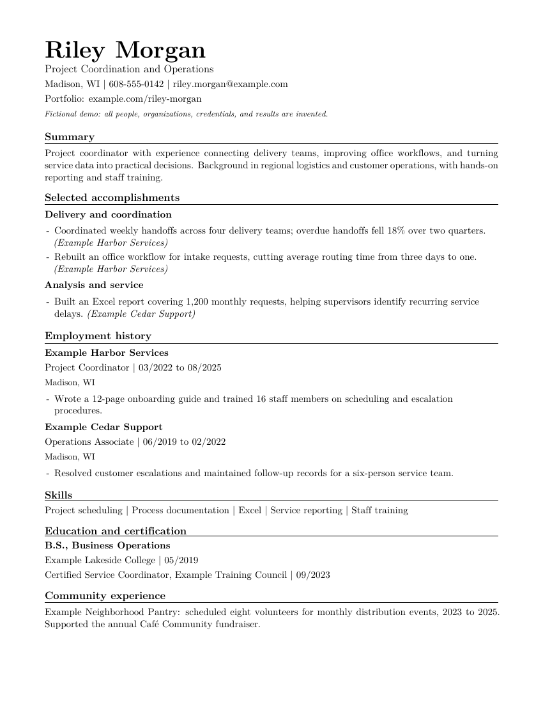
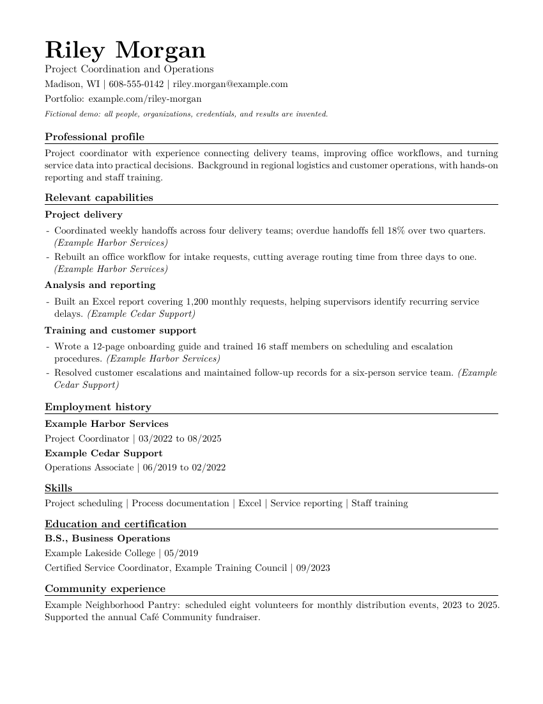
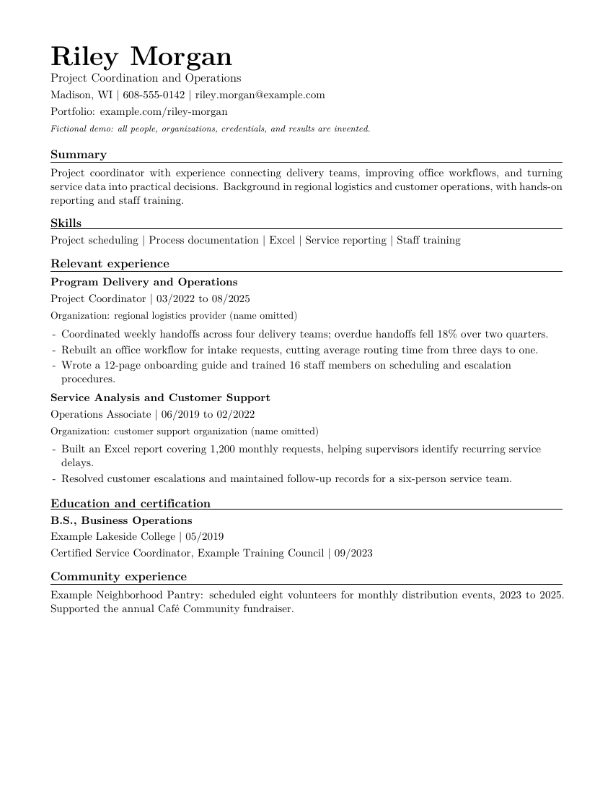
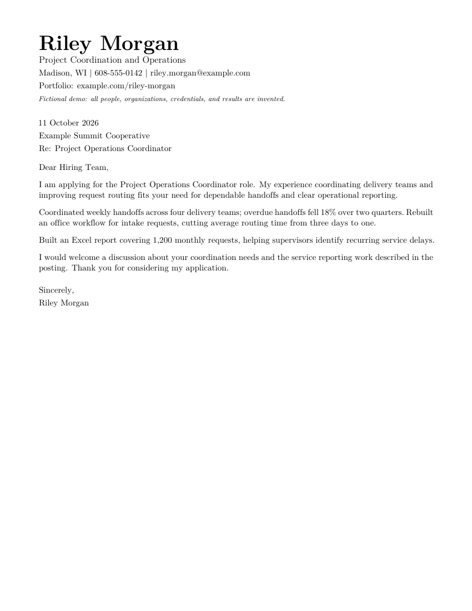

<div align="center">

# Resume Maker

**Build a resume you can explain, edit, and check.**<br>
Start with real evidence, tailor it to a job, and get a clean PDF plus the text an applicant tracking system reads.

[](https://github.com/trustdan/ai-resume-builder/actions/workflows/check-demo.yml)


[](LICENSE)

[**Get started**](docs/getting-started.md) · [Quick start](#quick-start) · [Formats](#compare-the-formats) · [Cover letters](#build-a-cover-letter) · [Commands](#commands) · [FAQ](#faq)


</div>

## Why Resume Maker?

- 📋 **Evidence first.** You record real experience before anything gets written, and nothing invented makes it into the final draft.
- 🧩 **Four structures from one source.** Chronological, hybrid, functional, and employer-light, plus a matching cover letter.
- 🔍 **Checks you can inspect.** Every build extracts the PDF's text and checks fonts, Unicode, and reading order.
- 🖥️ **Runs locally.** No Python packages, accounts, or API keys. Your records stay in an ignored `personal/` folder.
- 🤖 **AI optional.** Works with Cursor, VS Code, Claude Code, Codex, Antigravity, or no AI at all.

## New here? Pick how you want to work

You don't need to be a programmer. Choose a row, then follow the **[step-by-step guide](docs/getting-started.md)**.

| If you... | Use | Examples |
| --- | --- | --- |
| Want an AI to do most of the work in a point-and-click editor | An **AI code editor** | Cursor · VS Code + GitHub Copilot · Google Antigravity · Windsurf |
| Are comfortable typing a few commands | A **terminal AI agent** | Claude Code · OpenAI Codex CLI · Gemini CLI |
| Prefer to write everything yourself | **Any editor with a terminal** | VS Code · Zed |
| Only use ChatGPT/Claude/Gemini in a browser | **Browser chat + an editor**: the chat drafts wording, and you paste it in and build | Any of the above |

> [!TIP]
> Not sure? Install **VS Code** or **Cursor**, open this folder, and use its built-in AI chat. You can also run Claude Code or Codex in the editor's terminal. The [getting started guide](docs/getting-started.md#notes-for-specific-tools) covers each tool.

## Quick start

**1. Install the prerequisites:** Git, Python 3.10+, pdfLaTeX, and PDF tools. Use the [Windows](docs/setup-windows.md), [macOS](docs/setup-macos.md), or [Linux](docs/setup-linux.md) guide.

**2. Get the starter.** Click **Code > Download ZIP** above and unzip it, or clone it:

```text
git clone https://github.com/trustdan/ai-resume-builder.git
cd ai-resume-builder
```

**3. Open the folder in your editor** (**File > Open Folder**, choosing the folder that contains `resume.py`), open its terminal, and check your setup:

```text
python resume.py doctor
python resume.py build examples/demo-person --all
```

<details>
<summary>Using macOS, Linux, or seeing "python not found"?</summary>

On macOS/Linux, type `python3` wherever this README says `python`. On Windows, try `py -3` if `python` opens the Microsoft Store or isn't found. See [troubleshooting](docs/troubleshooting.md).

</details>

**4. Create your project:**

```text
python resume.py new personal/my-resume --variant hybrid
```

**5. Fill it in.** Choose one of the two paths below.

### With an AI assistant

Paste this into your assistant's chat:

> Read AGENTS.md and prompts/interview-me.md, run doctor, then help me create my resume under personal/my-resume. Ask about missing facts before drafting. Never invent metrics, qualifications, titles, or dates.

It interviews you, records verified facts, drafts, builds, and reviews. Approve its commands, and check every claim it writes. More prompts: [tailor to a job](prompts/tailor-to-job.md) · [cover letter](prompts/build-cover-letter.md) · [final review](prompts/review-resume.md).

### By hand

1. Record your real experience in `personal/my-resume/experience-inventory.md`, and put uncertain facts in its questions list.
2. Fill in `job-description.md` and `tailoring-brief.md` to connect the posting's requirements to your evidence.
3. Edit `candidate.tex`, which holds your reusable content. `hybrid/resume.tex` controls the order. Replace every `REPLACE ME`, and remove sections that don't apply. [LaTeX basics](docs/workflow.md).

**6. Build and check:**

```text
python resume.py build personal/my-resume
python resume.py review build/personal/my-resume/hybrid/resume.pdf
```

Your PDF is **`build/personal/my-resume/hybrid/resume.pdf`**. Read the adjacent `resume.default.txt` and `resume.layout.txt` (the extracted text), look over the PDF, verify your claims, and record the revision in `qa-log.md`. When your draft is complete, set `DocumentNotice` to `{}`. [Full workflow](docs/workflow.md).

## Compare the formats

Every example uses the same **fictional** candidate and career. The employers, credentials, and results are invented for teaching.

<table>
  <tr>
    <td align="center" width="33%"><a href="examples/previews/chronological.png"></a><br><b>Chronological</b></td>
    <td align="center" width="33%"><a href="examples/previews/hybrid.png"></a><br><b>Hybrid</b></td>
    <td align="center" width="33%"><a href="examples/previews/functional.png"></a><br><b>Functional</b></td>
  </tr>
  <tr>
    <td align="center"><a href="examples/previews/employer-light.png"></a><br><b>Employer-light</b></td>
    <td align="center"><a href="examples/previews/employer-light-anonymous.png"></a><br><b>Employer names omitted</b></td>
    <td align="center"><a href="examples/previews/cover-letter.png"></a><br><b>Cover letter</b></td>
  </tr>
</table>

| Format | What changes | Preview |
| --- | --- | --- |
| Chronological | Recent jobs lead the experience section | [PDF](https://github.com/trustdan/ai-resume-builder/raw/main/examples/previews/chronological.pdf) · [Image](examples/previews/chronological.png) |
| Hybrid | Selected accomplishments come first, followed by detailed employment history | [PDF](https://github.com/trustdan/ai-resume-builder/raw/main/examples/previews/hybrid.pdf) · [Image](examples/previews/hybrid.png) |
| Functional | Most detail sits under capabilities, and the history is compact | [PDF](https://github.com/trustdan/ai-resume-builder/raw/main/examples/previews/functional.pdf) · [Image](examples/previews/functional.png) |
| Employer-light | Responsibilities lead each job, and employers stay on a secondary line | [PDF](https://github.com/trustdan/ai-resume-builder/raw/main/examples/previews/employer-light.pdf) · [Image](examples/previews/employer-light.png) |
| Employer-light, names omitted | Organization descriptions replace employer names, and the other details remain | [PDF](https://github.com/trustdan/ai-resume-builder/raw/main/examples/previews/employer-light-anonymous.pdf) · [Image](examples/previews/employer-light-anonymous.png) |
| Cover letter | A matching, editable letter using the same facts | [PDF](https://github.com/trustdan/ai-resume-builder/raw/main/examples/previews/cover-letter.pdf) · [Image](examples/previews/cover-letter.png) |

A hybrid resume is a good starting point when transferable skills matter. Omitting employer names is a deliberate option with tradeoffs, and a skills-first resume doesn't require it. [Choose a format](docs/choose-a-format.md).

```text
python resume.py build personal/my-resume --variant chronological
python resume.py build personal/my-resume --variant employer-light --anonymous
python resume.py build personal/my-resume --variant cover-letter
```

The anonymous build goes to a separate output directory. It omits **employer names only** and doesn't fully anonymize the resume. Follow the application's instructions about history and file format.

## Build a cover letter

New projects include `cover-letter-brief.md` and `cover-letter.json`. Map the employer's needs to your verified experience, then write the letter as plain text in the JSON file. Your contact details and signature come from `candidate.tex`.

```text
python resume.py letter personal/my-resume
```

This generates an editable `cover-letter-content.tex`, builds `build/personal/my-resume/cover-letter/cover-letter.pdf`, and runs the PDF checks. To revise, edit the JSON and run `letter personal/my-resume --replace`, after saving a copy of any manual edits to the generated file. You can also edit the TeX directly. The builder formats the prose you supply; it doesn't invent or verify claims. [Cover letter guide and input fields](docs/cover-letters.md).

## ATS readability and flat layouts

All four formats use one column and ordinary text flow, with job titles and dates kept together. Keep the tested fonts and Unicode mappings, read both extracts in order, and look over every page. [ATS and flatness checklist](docs/ats-and-flatness.md).

The root and nested `AGENTS.md` files spell out the factual, layout, and review requirements, and every new personal project gets its own copy. Each has a one-line `CLAUDE.md` that imports it for Claude Code. If your editor doesn't load these files automatically, ask your assistant to read them. [Instruction-file scopes](docs/agent-guidance.md) · [Editor setup and tasks](docs/editors.md).

## Commands

| Command | Purpose |
| --- | --- |
| `python resume.py doctor` | Check executables and required TeX files without installing anything |
| `python resume.py new personal/NAME --variant hybrid` | Copy a complete editable project; refuses to overwrite an existing destination |
| `python resume.py build PROJECT --all` | Build all four resume structures and check the PDF text and fonts |
| `python resume.py letter personal/NAME` | Generate a cover letter from the project JSON, build it, and check it; `--replace` regenerates existing content |
| `python resume.py qa PROJECT --variant hybrid` | Check an existing output PDF and refresh the extracted text |
| `python resume.py review FILE` | Advisory writing review; not an authorship detector |

<details>
<summary>Maintainer commands</summary>

| Command | Purpose |
| --- | --- |
| `python resume.py previews` | Rebuild only the fictional demo PDFs and PNGs; needs `pdftoppm` |
| `python resume.py export --output build/release/resume-maker --zip` | Export the exact release allowlist as a folder and ZIP |

</details>

Run commands from the starter root. Project paths are resolved relative to `resume.py`, and quoted paths with spaces work. `--help` describes every option. Each new personal project gets its own copy of the four templates and their dependencies, so later template edits won't silently change your existing resume.

> [!NOTE]
> A successful build checks extractable text, font embedding, Unicode maps, and known corruption patterns. **PASS doesn't certify the resume for every ATS, and it doesn't verify your facts.** Always look over the PDF and both text extracts. [Quality checks](docs/pdf-quality.md) · [Troubleshooting](docs/troubleshooting.md).

## FAQ

<details>
<summary><b>Do I need to know LaTeX?</b></summary>

Barely. You replace text inside braces and start bullets with `\item`. Special characters need a backslash: `\%`, `\$`, `\&`, `\#`, `\_`. An AI assistant can handle this for you. [LaTeX basics](docs/workflow.md).

</details>

<details>
<summary><b>Do I need an AI subscription?</b></summary>

No. Every step works by hand, and the builder never contacts an AI service. An assistant speeds up interviewing and drafting. Many editors and agents offer free tiers.

</details>

<details>
<summary><b>Is my data uploaded anywhere?</b></summary>

The builder runs entirely on your computer, and Git ignores `personal/` and `build/`. If you use a cloud AI assistant, it sends what you share to its provider, so check that tool's privacy settings. [Sharing and privacy](docs/sharing-and-privacy.md).

</details>

<details>
<summary><b>Can I use this for federal resumes or academic CVs?</b></summary>

Those have their own requirements, which these templates don't check. Verify them separately.

</details>

## Share the starter

Keep applicant records under the ignored `personal/` folder and outputs under the ignored `build/` folder. Export a clean starter with the export command above, then initialize a separate repository with fresh history. The exporter includes only the fictional demos and explicitly reviewed files; it never copies personal work or Git history. [Sharing guide](docs/sharing-and-privacy.md).

**For maintainers:** [validation and limitations](docs/validation.md) · [release checklist](docs/releasing.md) · [MIT license](LICENSE) · [dependency notices](THIRD_PARTY_NOTICES.md)
