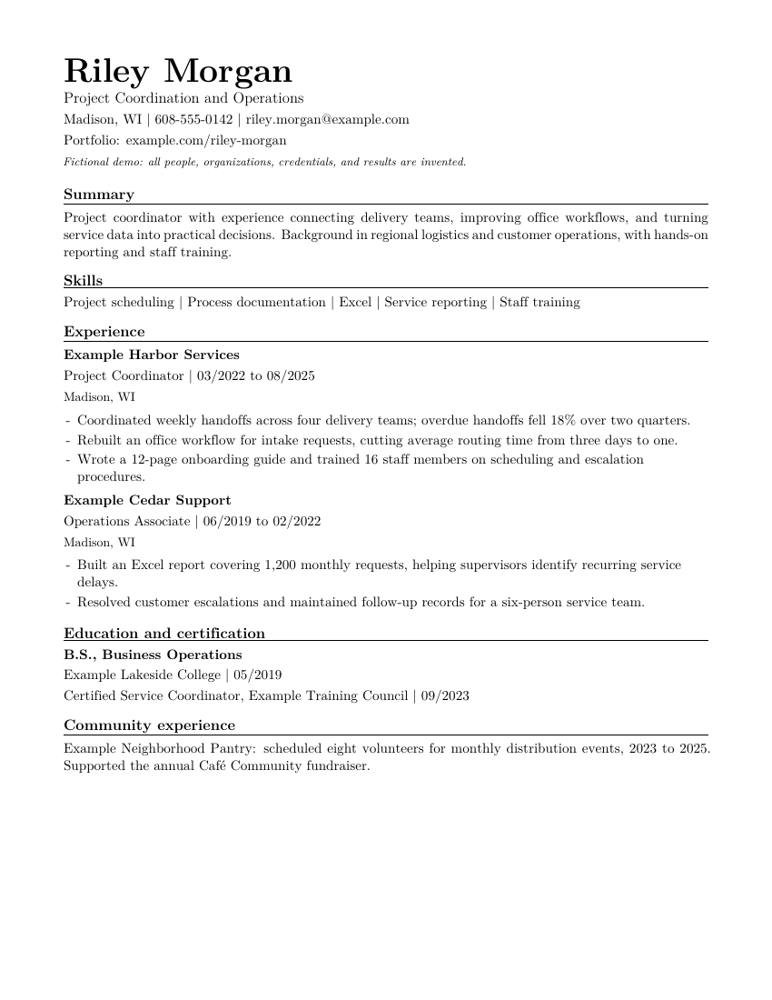

# Resume Maker

Build a resume you can explain, edit, and check. Start with real evidence, tailor it to a job, and generate a clean PDF plus the text a machine can read.



**Local tools, editable LaTeX, four resume structures.** Use VS Code, Cursor, Google Antigravity, Zed, or any editor with a terminal. AI assistance is optional. No Python packages, API keys, or cloud account are required.

## Start here

Install **Git, Python 3.10+, pdfLaTeX, and PDF tools** using the [Windows](docs/setup-windows.md), [macOS](docs/setup-macos.md), or [Linux](docs/setup-linux.md) setup guide. On macOS/Linux, use `python3` in place of `python` below; on Windows, `py -3` is another option.

After this starter has been published, substitute its actual account/repository in this clone command. Or download and unzip the shared starter folder, then open that folder in your editor.

```text
git clone https://github.com/YOUR-ACCOUNT/resume-maker.git
cd resume-maker
python resume.py doctor
python resume.py build examples/demo-person --all
python resume.py new personal/my-resume --variant hybrid
```

1. Open `personal/my-resume/experience-inventory.md` and record your actual experience. Put uncertain facts in its questions list.
2. Fill `job-description.md` and `tailoring-brief.md` to connect the posting's requirements with your evidence.
3. Edit `personal/my-resume/candidate.tex`. This holds the reusable content; `hybrid/resume.tex` controls its order. Replace all `REPLACE ME` values and remove sections that do not apply.
4. Build and inspect:

```text
python resume.py build personal/my-resume
python resume.py review build/personal/my-resume/hybrid/resume.pdf
```

Your PDF is **`build/personal/my-resume/hybrid/resume.pdf`**. Read the adjacent `resume.default.txt` and `resume.layout.txt`, inspect the PDF, verify claims, and record the revision in `qa-log.md`. Set `DocumentNotice` to `{}` when your personal draft is complete. [Full workflow and LaTeX basics](docs/workflow.md).

## Compare the formats

Every example uses the same **fictional** candidate and career. Employers, credentials, and results are invented for teaching.

| Format | What changes | Preview |
| --- | --- | --- |
| Chronological | Recent jobs lead the experience section | [PDF](examples/previews/chronological.pdf) · [Image](examples/previews/chronological.png) |
| Hybrid | Selected accomplishments lead; detailed employment history follows | [PDF](examples/previews/hybrid.pdf) · [Image](examples/previews/hybrid.png) |
| Functional | Most detail sits under capabilities; history is compact | [PDF](examples/previews/functional.pdf) · [Image](examples/previews/functional.png) |
| Employer-light | Responsibilities lead each job; employers remain on a secondary line | [PDF](examples/previews/employer-light.pdf) · [Image](examples/previews/employer-light.png) |
| Employer-light, names omitted | Organization descriptions replace employer names; other details remain | [PDF](examples/previews/employer-light-anonymous.pdf) · [Image](examples/previews/employer-light-anonymous.png) |
| Cover letter | A matching, editable letter using the same facts | [PDF](examples/previews/cover-letter.pdf) · [Image](examples/previews/cover-letter.png) |

A hybrid is a useful starting point when transferable skills matter. Omitted employers are a deliberate option with tradeoffs, not a requirement for a skills-first resume. [Choose a format](docs/choose-a-format.md).

```text
python resume.py build personal/my-resume --variant chronological
python resume.py build personal/my-resume --variant employer-light --anonymous
python resume.py build personal/my-resume --variant cover-letter
```

The anonymous comparison has a separate output directory. It omits **employer names only** and is not complete anonymization. Follow the application's instructions about history and file format.

## Build a cover letter

New projects include `cover-letter-brief.md` and `cover-letter.json`. Map the employer's needs to your verified experience, then write the letter as plain text in JSON. Your contact details and signature come from `candidate.tex`.

```text
python resume.py letter personal/my-resume
```

This generates editable `cover-letter-content.tex`, builds `build/personal/my-resume/cover-letter/cover-letter.pdf`, and runs the PDF checks. For revisions, edit JSON and use `letter personal/my-resume --replace` after preserving any manual generated-file edits. Direct TeX editing remains supported. The builder formats supplied prose; it does not invent or verify claims. [Cover letter guide and input fields](docs/cover-letters.md).

## ATS readability and flat layouts

All four formats use one column and ordinary text flow, with job titles and dates kept together. Preserve the tested fonts and Unicode mappings, read both extracts in order, and visually inspect every page. [ATS and flatness checklist](docs/ats-and-flatness.md).

The root and nested `AGENTS.md` files spell out factual, layout, and review requirements. Every new personal project gets its own instructions. Explicitly ask your assistant to read them if its editor does not load them automatically. [Instruction-file scopes](docs/agent-guidance.md).

## Use an AI assistant, if you want

Give it this prompt:

> Read AGENTS.md and prompts/interview-me.md, run doctor, then help me create my resume under personal/my-resume. Ask about missing facts before drafting. Never invent metrics, qualifications, titles, or dates.

Reusable prompts cover [fact gathering](prompts/interview-me.md), [tailoring](prompts/tailor-to-job.md), [cover letters](prompts/build-cover-letter.md), and [review](prompts/review-resume.md). Explicitly ask an assistant to read the instructions if your editor does not load them automatically. [Editor setup and optional tasks](docs/editors.md).

## Commands

| Command | Purpose |
| --- | --- |
| `python resume.py doctor` | Check executables and required TeX files without installing anything |
| `python resume.py new personal/NAME --variant hybrid` | Copy a complete editable project; refuse existing destinations |
| `python resume.py letter personal/NAME` | Generate a cover letter from project JSON, build, and check; `--replace` explicitly regenerates existing content |
| `python resume.py build PROJECT --all` | Build all four resume structures and check PDF text/fonts |
| `python resume.py qa PROJECT --variant hybrid` | Check an existing output PDF and refresh extracted text |
| `python resume.py review FILE` | Advisory writing review; not an authorship detector |
| `python resume.py previews` | Maintainers: rebuild only fictional demo PDFs and PNGs; needs pdftoppm |
| `python resume.py export --output build/release/resume-maker --zip` | Export the exact release allowlist as a folder and ZIP |

Run commands from the starter root. Project paths are resolved relative to resume.py; quoted paths with spaces work. `--help` describes all options. The four templates and their dependencies are copied into each new personal project, so later template edits do not silently change your existing resume.

A successful build checks extractable text, font embedding, Unicode maps, and known corruption patterns. **PASS is not universal ATS certification or factual verification.** Always inspect the PDF and both text extracts. [Quality checks](docs/pdf-quality.md) · [Troubleshooting](docs/troubleshooting.md).

## Share the starter

Keep applicant records under ignored `personal/` and outputs under ignored `build/`. Export a clean starter with the command above and initialize a separate repository with fresh history. The exporter includes fictional demos and explicitly reviewed files only; it never copies personal work or Git history. [Sharing guide](docs/sharing-and-privacy.md).

For maintainers: [validation and limitations](docs/validation.md), [release checklist](docs/releasing.md), [MIT license](LICENSE), and [dependency notices](THIRD_PARTY_NOTICES.md). Federal resumes and academic CVs need separate requirement checks.
